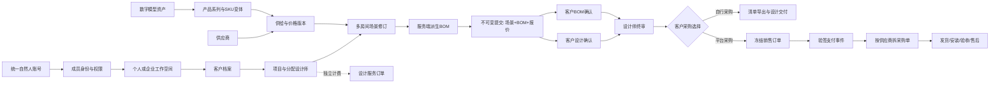
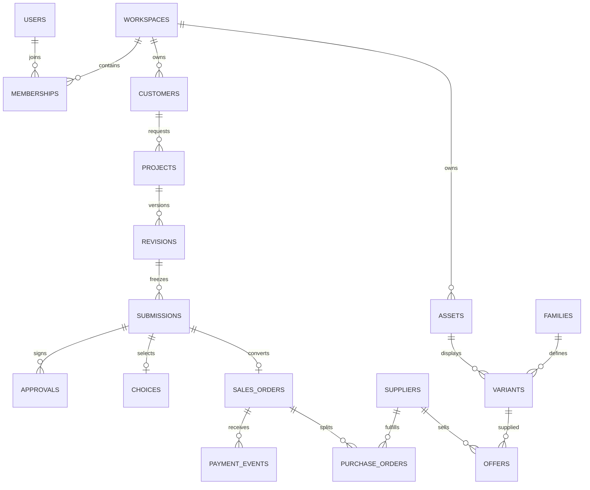

# 空间大师：系统边界与数据关联

需求基线：用户提供的《全量产品与技术开发总规格书 V2.0》。本文件是对需求的工程解释；收费、付款主体、分账、版权等待决策事项保持待决策。当前代码版本0.1.0是可执行的重写基础，能力边界见验收报告，不等于全量SaaS交付。

## 1. 统一业务链

## 2. 每个系统管理什么

| 系统 | 唯一真值与归属 | 上游→下游 | 访问限制/禁止事项 | 当前实现 |
| --- | --- | --- | --- | --- |
| 身份 IAM | users/sessions；自然人不因换企业而换账号 | 登录→成员→资源动作 | Cookie HttpOnly；每请求查成员有效性 | 基础账号/登录/邀请/撤权；找回、MFA未接 |
| 企业组织 | workspaces/memberships/invitations | 管理员邀请→本人接受→分配项目 | 一人多企业，离职只撤本企业；不转移个人资产 | 已实现基础角色，岗位细分待补 |
| CRM | customers.workspace_id + user_id | 客户→项目→受邀确认人 | 跨企业同一客户账号是不同客户档案；不以用户名当客户主键 | 管理员建档，客户须已有账号 |
| 项目协作 | projects.workspace_id/customer_id/designer_id | 客户→项目→场景版本→提交 | 企业设计师仅分配项目；管理员可转派 | 基础单方案、多房间数据结构；协作成员/有效期未接 |
| 空间引擎 | revision.scene；毫米为保存单位 | 实测/导入→场景→2D/3D/BOM | AI图片不修改几何；真实SKU尺寸不可任意拉伸 | 画墙/拖角/墙长/门窗开洞/上下移动/顶面基础能力 |
| 资产中心 DAM | assets: SHA256、大小、归属、原文件 | 分片→校验→不可变文件→模型映射 | 不允许前端指定已有modelId冒领；设计师默认不能取原件 | GLB分片存储，状态stored_unverified；处理队列/派生模型未接 |
| 商品 PIM | family→variant；毫米尺寸、SKU、asset_id | 模型+产品参数→SKU→场景实例 | 模型不是商品；同名SKU可分别属于不同企业 | 基础系列/变体已实现；多模型映射、套装/定制未接 |
| 供给与价格 | offers.variant_id/supplier_id/sale_fen/cost_fen/version/valid_until | 供给→BOM→冻结报价→销售 | 售价与成本分开；财务/管理员才读成本 | 基础供给与有效期；税费/运费/地区/阶梯价未接 |
| 设计审核 | submissions.payload/hash + approvals | 修订→提交→双确认→终审 | 客户只看脱敏快照；退回产生下一修订；旧确认永不覆盖 | 已实现；评论为文本，受限登录无匿名链接 |
| 设计服务交易 | design_service_orders（目标） | 委托/合同→服务费/退款/结算 | 与产品货款、采购金额分开，不绑客户采购路径 | 仅service_orders预留表，业务未实现 |
| 双采购 | choices.submission_id | 终审→自购或平台购 | 同快照一次选择；自购不建商品订单；转换需新报价 | 已实现基础分支 |
| 销售 OMS | sales_orders+冻结订单行 | 选择平台购→订单→付款→履约 | 不信客户端金额；不可直接按钮标真付款 | 仅商品订单基础，正式付款/退款/税票未实现 |
| 支付账务 | payment_events(provider,event_id) | 签名回调→事务→库存/采购 | 验签、金额币种核对、事件去重、订单去重 | 仅显式开启HMAC沙箱；不是正式支付 |
| 供应链采购 | purchase_orders(order_id,supplier_id) | 验证付款→按供应商拆单 | 供应商只看自己的采购价，不见客户销售价 | 接单/发货基础；收货、安装/售后未实现 |
| AI/渲染 | render_job(修订ID/输入/输出/费用)（目标） | 真实场景+机位→任务→图片 | 无权改变原结构；Key不进浏览器 | 未实现，没有假出图按钮 |
| SaaS计费 | usage/plan/ledger（目标） | 席位/存储/渲染用量→计费 | 不编码固定佣金；不与商品采购混账 | 未实现 |
| OMEE运营 | 用户/供应商注册/审计；任务授权 | 平台配置→各域 | 平台管理员不自动获得企业全部私有项目 | 基础后台及审计；审批/运营报表待建 |
| 运维发布 | 代码版本、DB版本、资产散列、备份 | 测试→备份→发布→回滚 | 不覆盖旧生产数据；不执行删除卷 | 备份/校验/只读盘点脚本，未部署 |

## 3. 主键、外键、版本

场景对象为 `{id, roomId, source, variantId, offerId, x,y,z,width,depth,height,rotation}`。保存单位mm、旋转弧度；3D渲染时除以1000转换为m。`source=existing`从采购BOM剔除；`source=new`必须引用本工作空间的SKU与供给，宽深高必须匹配真实SKU。SQL中families/variants/assets/offers用复合外键约束归属；项目客户归属由服务层额外校验。公共库与跨企业授权尚未实现，不能跨空间粘贴引用。

场景采用rooms数组，墙为points闭合轮廓和稳定wallIds，门窗引用wallId+offset/width/height/sill，材质基础颜色在房间，未来应迁为每墙材质槽。当前UI编辑首房间，数据不锁死单房间。场景数据不是DWG解析结果，也不声称已有自动识别。

每次成功保存：检查expectedVersion→校验几何与SKU归属→增加project.version→插入不可变revision。草稿可继续编辑；提交后不可直接覆盖。提交持有revision_id，冻结场景与供给价格、数量、供应商，并计算SHA256。客户接口只投影公开字段；内部成本不返给客户。

SHA256用于版本一致性与追溯，不是法律电子签章。客户确认保存actor_id、时间、确认范围和快照hash。两项确认都存在才能终审。锁版后由fork建立新草稿，不修改旧提交；旧订单仍引用原提交。

## 4. 状态规则

项目：`draft → under_review → changes_requested → draft`，或 `under_review → finalized → self_completed / ordered`；锁版或交付后可fork到新草稿。

提交：`client_review → changes_requested`，或两条独立approval后 `client_approved → finalized → self_completed / ordered`。终审不是客户确认的替代操作。

销售订单：`awaiting_payment → paid_sandbox`。这两个状态仅覆盖开发沙箱；正式支付必须新增真实Provider及异常/退款状态，不能把paid_sandbox更名为paid上线。

采购单：`pending → accepted → shipped`，当前只允许本供应商按顺序操作；目标还有received/installed/accepted/after_sale，当前没有这些假操作。

上传：`uploading → completed`；资产状态为`stored_unverified`，明确表示完成二进制校验、尚未证明视觉可用。未来资产处理队列再扩展processing/ready/failed。

## 5. 一致性与边界

- 采购选择、订单创建、审核状态、支付记录、扣库存与拆采购单均在数据库事务内完成；支付去重以provider+event_id约束，并以order_id+supplier_id唯一约束兜底。
- 所有销售金额为整数分，几何为整数毫米。采购单保存供货成本，不复制销售利润；客户接口不返回成本或供货商ID。
- 上传每片4MiB，初始化绑定用户和工作空间，完成时校验全文件SHA256与GLB头、自包含依赖；文件名为服务端UUID，无用户路径拼接。
- 文件系统与SQLite不能做跨介质原子提交。原件先写后登记：崩溃可能留下孤儿文件，必须对账；不会把孤儿文件冒充已登记可用资产。当前缺少后台自动孤儿清理与上传配额，生产前补齐。
- 原件下载限制owner/admin/product_manager。普通设计师的受限展示派生模型尚未生成，因此3D显示明确失败提示。浏览器收到GLB字节后无法技术上保证“只可观看不可下载”；要配合轻量派生、水印与合同授权，不能口头承诺防复制。
- 当前SQLite WAL适合单机开发验收；生产目标PostgreSQL+对象存储+异步任务，迁移时保留此领域约束，不简单替换连接字符串。

## 6. 迁移与跨系统事件设计

先只读盘点旧3000/3100/3200数据目录及卷，备份数据库JSON和模型文件，保留SHA256与路径。旧数据以`legacy_source + legacy_id`建立映射：人员人工认领→工作空间归属→资产哈希→SKU尺寸确认→项目版本→历史报价。缺单位/归属/原始模型的记录进入隔离清单，不自动猜测企业所有者，不信旧前端price或supplier文本直接生成真订单。代码归档不是服务器快照；本次没有生产文件和数据库，未执行迁移。

生产跨进程任务使用事务outbox：`AssetStored→AssetProcessing→AssetReady/Failed`；`SubmissionFinalized→NotifyCustomer`；`PaymentVerified→ProcurementCreated→SupplierNotification`；`ShipmentUpdated→InstallationTask→AcceptanceRecorded`。消息需带eventId/workspaceId/resourceId/version，消费者按eventId幂等。当前同进程事务没有伪造消息队列。

## 7. 需要业务确认的规则

登录渠道与找回、支付主体与代收/分账、设计费收取与退款、公开供应商信息范围、模型外部授权和版权、首发多房间深度、佣金/套餐额度、施工交付责任、AI Provider可用地区。当前均未写固定商业规则。
