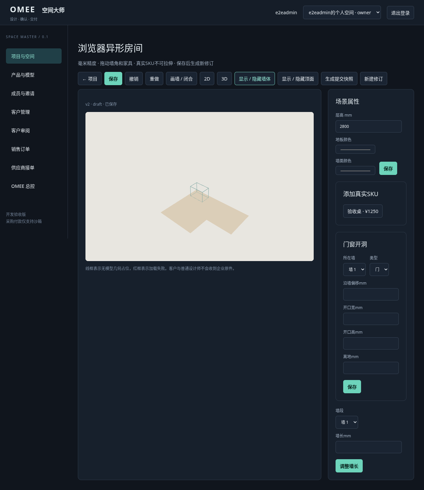
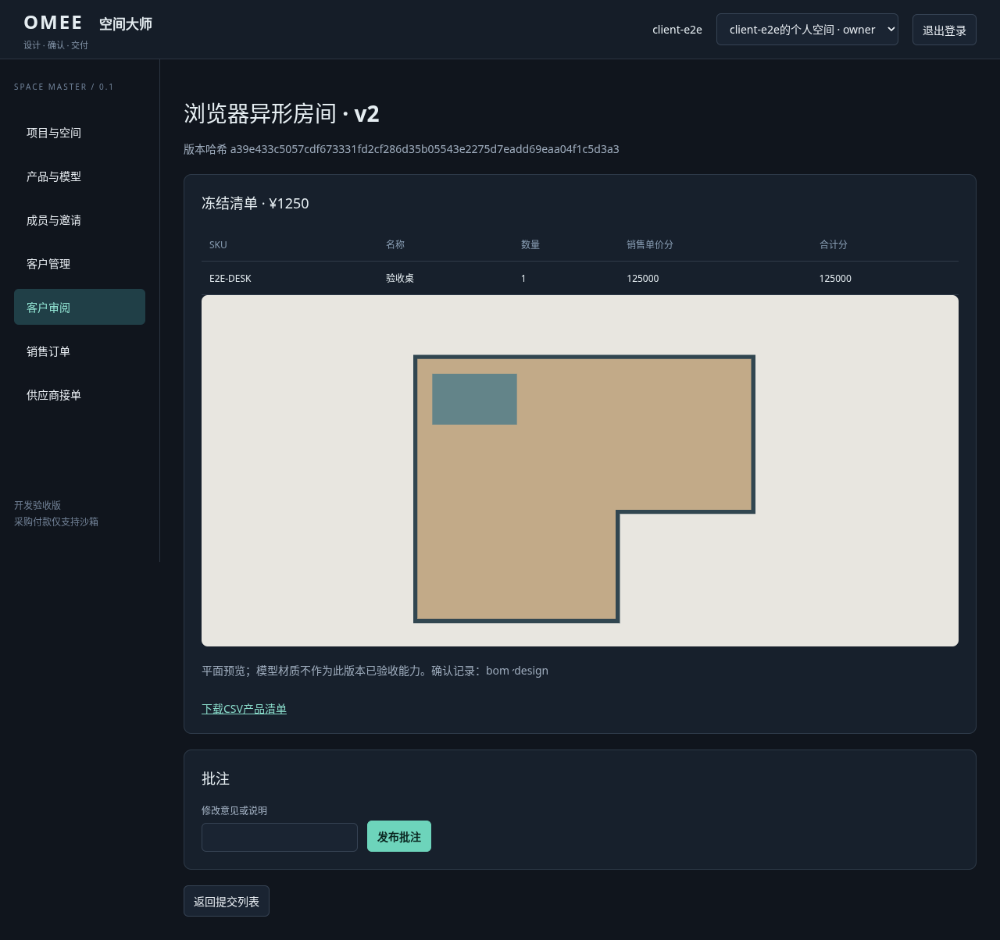

# 重写版本0.1.0：验证报告与差距

范围：用户所附历史代码ZIP、V2.0规格书；独立开发目录、本地SQLite与Chromium。未访问腾讯云或生产数据。测试账号仅是自动创建、销毁的隔离测试账号；未提供默认公网测试密码。

本轮执行结果：12项Node测试通过；1项Chromium跨账号业务流程通过。

## 已验证

| 层次 | 用例 | 结果与限制 |
| --- | --- | --- |
| 领域/数据库 | 租户隔离、项目分配、A企业撤权仍保留个人及B企业 | 通过；实际执行revoke，不沿用旧测试标题 |
| 领域/数据库 | SKU可信核价、成本字段脱敏、非客户拒绝审阅 | 通过；价格源为offers，不是前端手填BOM |
| 领域/数据库 | expectedVersion冲突、提交后禁覆盖、SHA256绑定、双确认 | 通过；旧提交/审批不变，锁版后fork新修订 |
| 领域/数据库 | 自购没有商品销售/采购单；独立服务费不受选择影响 | 前一项通过；服务费仅预留表，未测试/未实现交易 |
| 领域/数据库 | 100次相同沙箱付款事件，及不同eventId重复通知 | 通过；单供应商一次扣库；另有两供应商用例验证拆为两张且重放100次不重拆。未宣称平台采购多供应商浏览器实测 |
| 领域/数据库 | 错金额、过期供给报价、失败事务回滚 | 通过；真实支付异常/退款仍未实现 |
| 领域/数据库 | 退回修改、SKU越权引用、SKU变形 | 通过 |
| 资产/存储 | 小型合成GLB分片、全文件散列、原件权限、重复完成、重开DB | 通过；不证明真实大模型材质或500MiB容量 |
| 几何函数 | 自交轮廓、超墙门洞 | 通过；不是完整施工/碰撞审查 |
| HTTP | Cookie登录/退出、真实保存读取、401/403/409/422、跨站拦截、错误支付签名 | 通过；未进行渗透测试 |
| 备份恢复 | 数据库备份与散列校验、隔离目录恢复、损坏备份拒绝 | 通过；小数据集，无真实生产恢复证明 |
| 真实浏览器 | 创建客户→项目→鼠标画六角L形墙→保存刷新仍六角→3D→提交 | 通过；Chromium，可见Three.js场景，使用真实SKU的线框，无真实GLB材质样本 |
| 真实浏览器双账号 | 独立客户登录→设计/BOM分项确认→设计师终审→客户自购→导出入口→销售单为空 | 通过；真实SKU与供给由认证API准备，浏览器添加/拖动商品、确认1250元清单并实际请求CSV，检查有SKU且无成本；自购后销售单为空 |

测试源码为test/*.test.mjs与e2e/workflow.spec.mjs。执行`npm test`及`npm run test:e2e`复验。浏览器截图见evidence目录；截图为自动化测试数据，不是生产部署截图。CI配置已提供，远程GitHub Actions执行结果需另查，不把本地通过说成远程已绿。

## 浏览器实测修复

首次浏览器验收暴露：表单select缺精确可访问标签；画布pointerup重建导致墙角click丢失；SVG的hidden赋值不能正常切换显示。已在前端修正，并以重跑用例检查保存后六角与3D时2D隐藏。接口200无法发现这些问题。

## 需求覆盖：开发边界

| V2需求组 | 当前范围 | 尚未完成 |
| --- | --- | --- |
| AUTH-01~04 / ORG-01 | 登录、管理员建用户、个人/多企业、邀请接受、撤权、基础岗位和项目分配、成本投影 | 自助注册、找回、MFA、冻结界面、项目多人授权与有效期、细粒度角色 |
| CRM-01 / PROJ-01~02 | 客户归属、项目、房间数组、版本、快照、乐观锁、转派、备份 | 完整CRM/设计委托/多方案UI/跨主体协作；生产数据迁移 |
| SPACE-01 / EDIT-01 | 鼠标画墙、拖墙角、墙长、3D共源、Y轴/落地/吸顶、真实顶面 | 墙吸附、结构锁、复杂梁柱/设施、2D门窗符号、专业工程碰撞/净空 |
| SPACE-02~03 | 无假识别 | CAD/DXF/DWG、图片/PDF校准、实拍测量均待开发 |
| SPACE-04 / EDIT-02~03 | 墙段ID、门窗数据与3D开洞、房间墙地基础颜色 | 分墙段PBR、纹理比例、RGB光源、消防/电气/承重规则 |
| ASSET-01~04 / SKU-01 | 自包含GLB分片、SHA256、不可变原件、元数据、系列/SKU/供给 | 大GLB真样本、贴图/压缩兼容验收、多格式转码、对象存储、任务队列、受限派生资源、授权/公共库 |
| BOM-01~02 / REVIEW-01~02 | SKU清单、existing剔除、销售价冻结、双确认、退回/文本批注/终审、CSV | PDF/Excel、图上批注、受限匿名分享、法律签署、报价税运费与有效性复杂规则 |
| BUY-01~02 / ORDER-01~02 | 自购完整数据清单、平台待付单、沙箱验签/扣库/供应商拆单、供应商接单发货 | 正式支付、订单异常/退款、部分发货、物流/安装/验收/售后/账务、设计服务费交易 |
| AI-01~03 / BILL-01 / SKU-02 | 未实现 | AI/全景/视频、套餐计费/佣金、定制/模组全部待开发 |
| ADMIN-01 / OPS-01 | 用户与供应商注册、审计、HTTPS配置约束、只读盘点、备份/恢复校验、CI | 正式部署、监控/容量/密钥治理、合规和安全审计、灰度回滚演练 |

## 后续依赖顺序

1. M0：提供真实服务器只读清单与受控备份，按所有权/单位/散列对账，冻结可回滚旧版。
2. M1：用真实81MB手办与100MB+模型验收原材质/尺寸/刷新持久化；完成授权派生模型、GLB依赖安全扫描与容量控制。
3. M2：按已确定格式做图片校准、DXF候选与人工校正，补完整门窗设施/碰撞/结构锁。
4. M3–M4：生产数据库/对象存储、完整岗位/多人协作、设计服务交易、受限客户分享与导出。
5. M5：业务方确定支付主体/PSP与费用规则后接正式支付、异常退款、供应商多批次物流/安装/售后与对账；沙箱不能直接上线收款。
6. M6–M7：真实Provider、用量账本、订阅、监控与试点全链浏览器验收。

## 不作完成承诺的事项

没有把所有V2需求标记完成。未把GLB头校验当作视觉保真；未把无模型SKU的线框当作真实模型保真；未把小GLB用例当作500MiB容量通过；未把沙箱当作真实收款；未把重写原型当作可公网商用的成品。

## 浏览器截图

## 隔离验收准备补充

为后续腾讯云独立测试实例准备9角色随机账号、企业X/Y、可编辑项目、客户双确认样例、2350元SKU清单与2张预置沙箱供货单。新增3项回归后`npm test`共15项通过，原Chromium跨账号E2E仍通过；隔离实例9账号HTTP登录/越权/脱敏/付款关闭检查通过。

新增测试配置的真实部署仍受阻于腾讯云主机IP与安全连接未提供。开发环境的127.0.0.1:3301不是用户可访问的公网测试网址。Docker模板未构建验证（当前环境本地Docker套接字无访问权限），不能将Node进程实测等同于目标Docker部署通过。

## 家具空库反馈修正

用户验收截图显示v1空白草稿，添加SKU区没有条目；由于截图未含工作空间和项目标题，不能断言拖拽引擎故障或确认用户所在空间。已确认旧界面没有空库原因说明。本次增加编辑器所属空间标签、空库提示与返回入口；目录请求绑定项目所属空间，并丢弃切换空间后的过期响应。新增空企业库浏览器回归，验证不显示个人空间的SKU。Chromium共2项通过（含原有添加、拖动、保存刷新与客户交付流程）。修正已准备进入审阅分支，腾讯云仍运行f29dccc固定版本，尚未替换前端文件。

## 用户反馈后的代码自检

后续自检修正了家具交互、保存竞态、工作空间恢复、只读方案、旧提交采购覆盖新草稿、跨空间上传上下文和备份遗漏资产等问题，详见[代码自检与修复报告](代码自检与修复报告.md)。服务端与工具测试现为20项；浏览器已有8个通过用例，整组7项加后续3D与上传专项的执行方式与限制在自检报告说明。腾讯云测试站仍需另行更新，不能将仓库结果当作线上通过。
